# TechBazaar — Retail Sales Analytics (SQL · Python · Power BI-ready)

End-to-end analysis of **38,358 orders (₹195.5 Cr billed revenue)** from an Indian consumer-electronics retailer, Jan 2022 – Dec 2023: data validation, cleaning, **13 business questions in SQL** (CTEs, window functions, RFM with `NTILE`), KPI charts, and a Power BI-ready Excel workbook.


---

## Business problem
TechBazaar sells laptops, TVs, smartphones, tablets and accessories in five metro cities. Leadership wants to know:

1. Are we growing, and where does growth come from (cities, categories, products)?
2. How seasonal is demand, and what really happens in the Oct–Nov festive season?
3. Is discounting worth it — does it buy volume or just give away margin?
4. Who are our best customers, how many come back, and who is about to lapse?

## Dataset
| | |
|---|---|
| Source | `dashboard/TechBazaar_KPI_PowerBI_ready.xlsx` → sheet `Sales_Data` (exported to `data/sales_data.csv`) |
| Size | 38,358 orders × 18 columns, one row per order, 1 Jan 2022 – 31 Dec 2023 |
| Coverage | 8,880 customers · 25 products · 5 categories · 5 cities (Delhi, Mumbai, Bangalore, Chennai, Kolkata) · 5 payment modes |
| Columns | Order Id, Date, Customer Id, City, Category, Product Name, Quantity, Base Price, Discount Pct, Unit Price, Total Amount, Cost Price, Profit, Payment Mode, Year, Month, Month Name, Profit Margin Pct |

The workbook's second sheet, `Summary`, holds the headline KPIs used for the Power BI dashboard.

## Data quality — what I checked and how I handled it
Every rule is in `src/eda_and_cleaning.py`; results are saved to `outputs/data_quality_checks.csv`.

| Check | Result |
|---|---|
| Missing values, duplicate order IDs, duplicate rows | **0** |
| `unit_price = base_price × (1 − discount%)` | holds for **100%** of rows |
| `profit = (unit_price − cost_price) × quantity` | holds for **100%** of rows |
| `cost_price = 70% of base_price` | holds for **100%** of rows → the data is almost certainly **synthetic** |
| `total_amount = quantity × unit_price` (±1%) | **fails for 87.8%** of rows (ratio 0.78 – 1.65) |
| Supplied `Profit Margin Pct` | equals `profit ÷ total_amount` — mixes two different bases |
| `total_amount ≥ quantity × cost_price` | fails for **147 rows** (0.38%; 140 of them in February) |
| Customers buying in more than one city | **89.7%** of customers (2.8 cities each on average) — IDs look randomly assigned |

**The key finding:** `total_amount` is not `quantity × unit_price`. The gap follows the calendar: the ratio averages **0.92 in February** and rises to **1.32 in October and 1.34 in November** (chart below). It looks like a seasonal factor applied to the billed amount, while `profit` is computed on `quantity × unit_price`.

**How I handled it (nothing is dropped):**
- **Billed revenue** = `total_amount`, as recorded. It matches the Excel/Power BI KPIs, so all revenue figures use it.
- **Net sales** = `quantity × unit_price`, added as a column. This is the base `profit` is defined on.
- **Margin** = `profit ÷ net sales`, weighted (`SUM/SUM`), never an average of row percentages. The original column is kept as `margin_pct_on_total_amount` so nothing is hidden.
- Rows billed below cost are flagged (`billed_below_cost`) so they can be filtered in BI.
- The supplied queries were corrected (see [SQL highlights](#sql-highlights)).

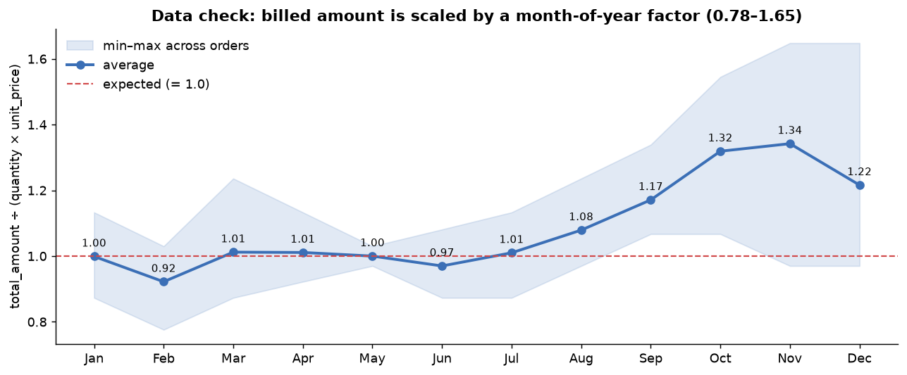

## Approach
1. **Validate & clean** (`src/eda_and_cleaning.py`): 12 rule checks, snake_case columns, typed dates, derived fields (`net_sales`, `margin_pct`, `quarter`, `year_month`, `weekday`, `is_festive_season`, `discount_band`, `billed_below_cost`) → `data/sales_cleaned.csv` and `outputs/yoy_summary.csv`.
2. **SQL** (`src/load_and_query_sql.py`): builds `data/techbazaar.db` from `sql/schema.sql` (typed table, CHECK constraint, indexes), runs the 13 queries in `sql/business_queries.sql`, and saves each result to `outputs/sql/`.
3. **Charts** (`src/make_charts.py`): 7 charts built from the SQL outputs → `images/`.

## Key insights
| KPI | 2022 | 2023 | YoY |
|---|---:|---:|---:|
| Billed revenue | ₹96.31 Cr | ₹99.15 Cr | **+2.95%** |
| Net sales (qty × unit price) | ₹89.31 Cr | ₹91.60 Cr | +2.56% |
| Profit | ₹22.00 Cr | ₹22.48 Cr | +2.16% |
| Margin on net sales | 24.64% | 24.54% | −0.10 pp |
| Orders | 19,017 | 19,341 | +1.70% |
| Avg order value (billed) | ₹50,643 | ₹51,264 | +1.23% |

1. **Growth is slow, and profit is growing more slowly than revenue.** Billed revenue rose 2.95%, but profit rose only 2.16%, and margin slipped from 24.64% to 24.54%.
2. **Discounting gives away margin without buying volume.** Margin falls from **30.0% with no discount to 12.5% at 20% off**, while units per order stay flat (1.136 → 1.122). Discounts cost **₹13.99 Cr** of list price over two years. 20% of orders carry a 15–20% discount. → Cap routine discounts at 10% and test deeper ones with a holdout.
3. **The festive "peak" is in the billed amount, not in demand.** In Oct–Nov, billed revenue per month is **29% higher** than the rest of the year (₹10.03 Cr vs ₹7.77 Cr). But orders per month are only **1.4% higher** (1,617 vs 1,595), and net sales only 1.6% higher. The uplift comes from the seasonal billing factor above. → Confirm what `total_amount` includes (festive pricing, bundles, taxes?) before planning inventory on it.
4. **Delhi leads and is growing; Mumbai is shrinking.** Delhi is the largest market (₹54.96 Cr, 28.1% share) and grew **+6.7%**. Mumbai, #2 at ₹48.65 Cr, is the only city that declined (**−2.1%**). AOV (₹50.7k–51.2k) and margin (24.5–24.7%) are nearly identical across cities, so the gap is order count, not basket size.
5. **Laptops + TVs are 58% of revenue; Accessories are the fastest-growing.** Category margins are flat (24.5–24.7%), so the mix matters for revenue, not for margin. Accessories grew **+11.5%** but are only 3.2% of revenue, which makes them a cross-sell opportunity. The top 2 products, **LG 55" OLED (₹23.17 Cr) and MacBook Air M2 (₹20.59 Cr)**, bring in 22.4% of revenue.
6. **Customers are loyal, and the top segment is concentrated.** 93.8% of the 8,880 customers ordered more than once (4.32 orders on average), and 88.3% of 2022 buyers bought again in 2023. In the RFM model, **Champions are 21.6% of customers but 33.9% of revenue**. **At-risk customers (1,486, last order ~249 days ago) hold 20.0% of revenue**; they are the first win-back target. The top 10% of customers bring in 23.3% of revenue.
7. **Payments:** UPI is the most used mode (35.0% of orders). Credit card is next (25.1%), and EMI is 8.0%. EMI has the highest AOV (₹52,482 vs ₹49,983 for UPI). The mix is almost the same in every city.

> These results come from a synthetic dataset. They show the method and the business framing; they are not real market findings.

## Charts
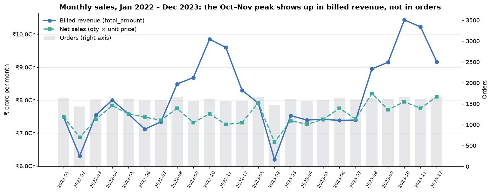

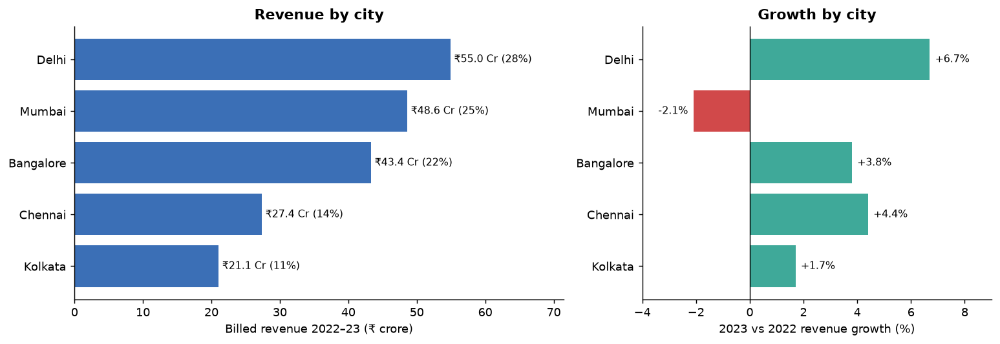

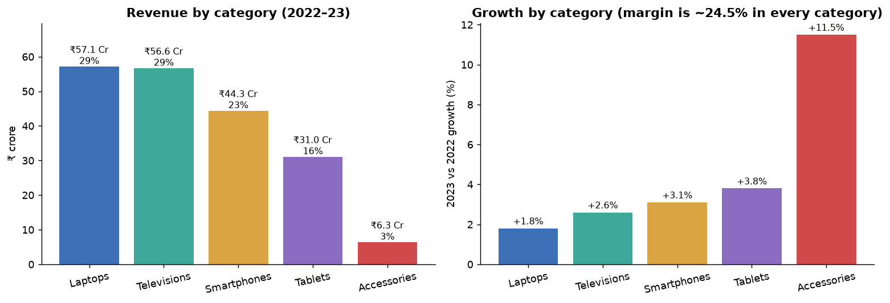

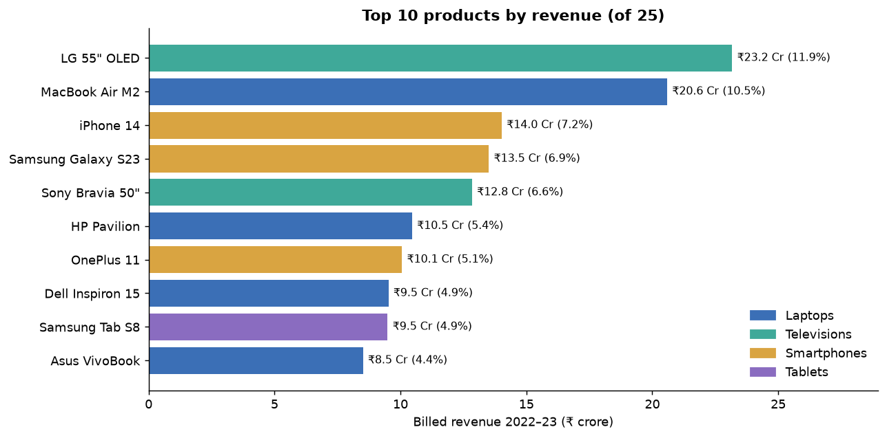

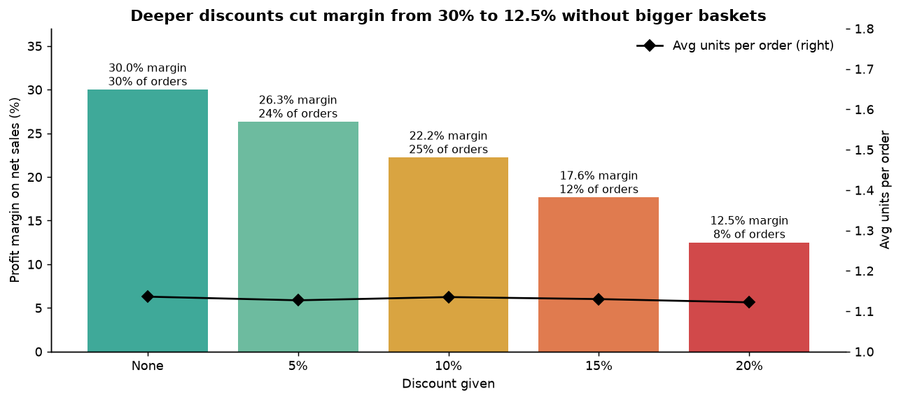

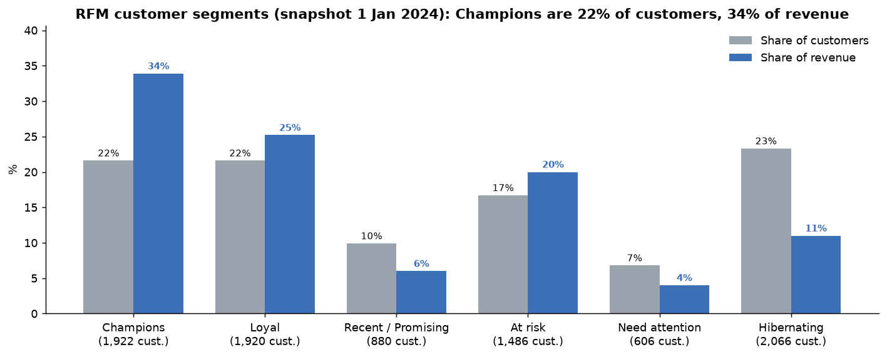

<details>
<summary>First-pass charts from my original notebook (<code>images/original/</code>)</summary>

These came before the data-quality review. Note that `avg_margin_by_category_row_avg.png` averages the supplied row-level margin (profit ÷ total_amount). That is why it shows 22–24% instead of the ~24.5% weighted margin on net sales.

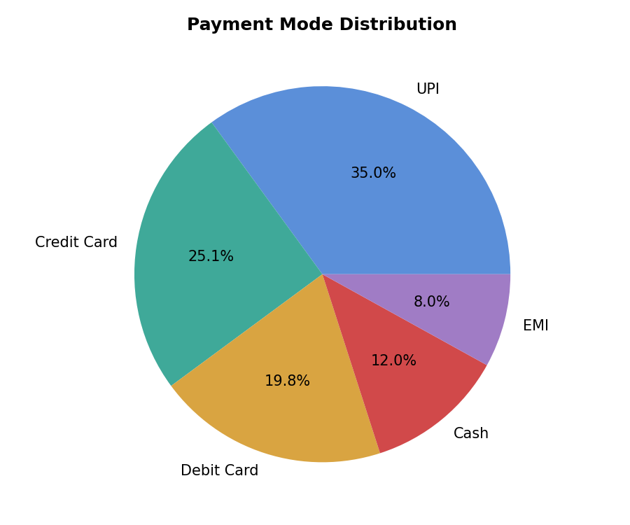
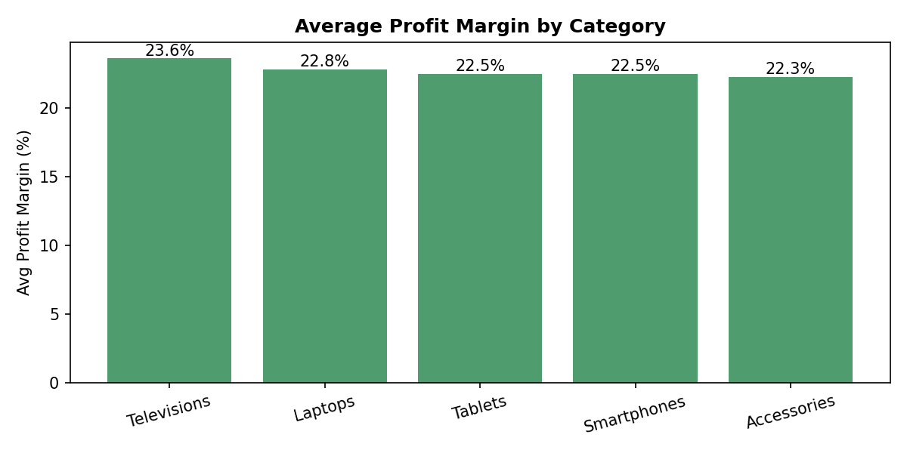
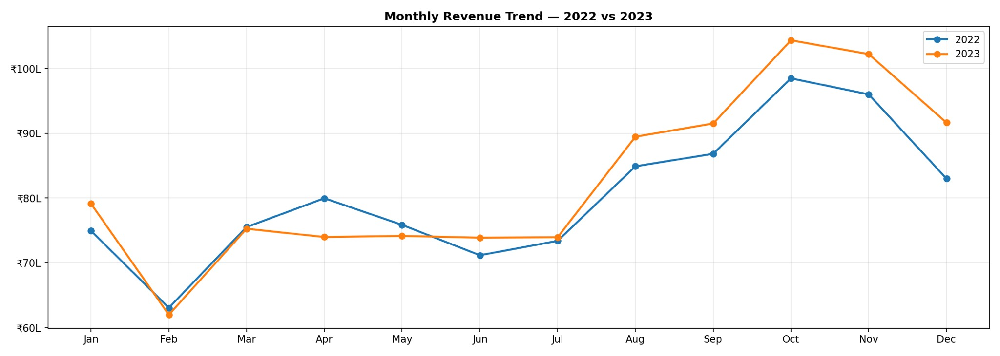
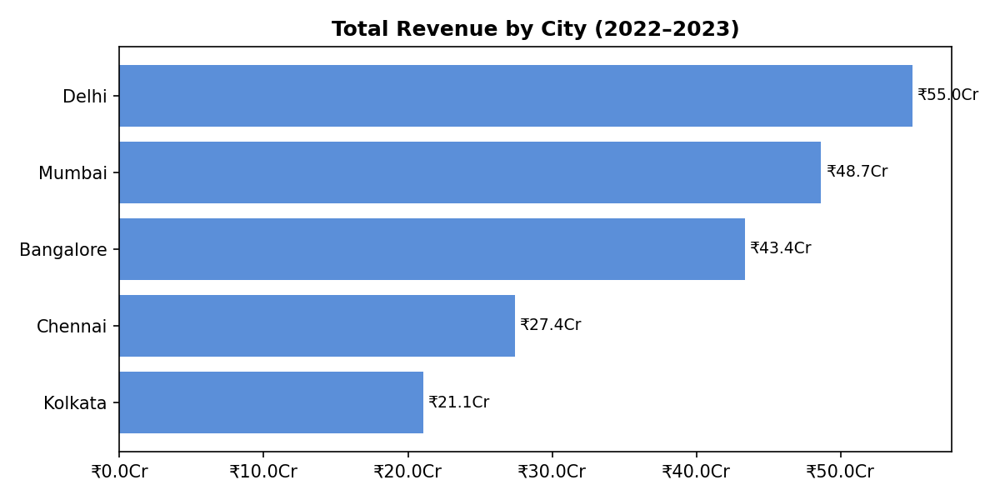
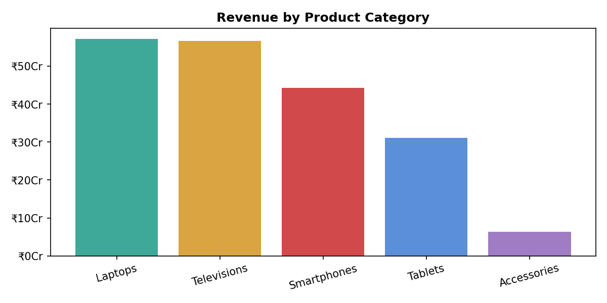
</details>

## SQL highlights
All 13 queries are in [`sql/business_queries.sql`](sql/business_queries.sql); each result is a CSV in [`outputs/sql/`](outputs/sql/).

| # | Question | Techniques |
|---|---|---|
| Q1 | Yearly KPIs and YoY growth | CTE, `LAG()` |
| Q2 | Monthly trend: MoM %, 3-month moving average, same-month YoY | `LAG(x, 12)`, `AVG() OVER (ROWS BETWEEN 2 PRECEDING …)` |
| Q3 | Festive season vs rest (per-month averages) | CTE, conditional grouping |
| Q4 | Category revenue/profit share, margin, YoY | `SUM() OVER ()`, `RANK()`, conditional aggregation |
| Q5 | Top 10 products, with rank inside their category | `RANK() OVER (PARTITION BY …)` |
| Q6 | City scorecard: share, customers, AOV, margin, growth | window share, `COUNT(DISTINCT)` |
| Q7 | Discount level vs margin, basket size, discount ₹ given | weighted margin |
| Q8 | Discount depth by category | `CASE` aggregation |
| Q9–Q10 | Payment mode mix, AOV, and a city × payment pivot | pivot with `SUM(condition)` |
| Q11 | Repeat rate, order-frequency bands, 2022→2023 retention | `UNION ALL` metric table |
| Q12 | RFM segmentation | `julianday()`, `NTILE(5)`, rule-based segments |
| Q13 | Top 10 customers and the top-decile revenue share | `ROW_NUMBER()`, `NTILE(10)`, scalar subquery |

Corrections to the first version of the queries:
- Margins used `AVG(profit_margin_pct)`, an unweighted mean of a mixed-base column. They are now `SUM(profit)/SUM(net_sales)`.
- The monthly YoY query divided by 1,000,000 but labelled the result "lakh" (1 lakh = 100,000).
- "Festival vs rest" compared 2 months of total revenue with 10 months. It now compares per-month averages.
- Discount buckets merged the 5% and 10% levels. Each real level is now shown.

```sql
-- Q12 (excerpt): RFM scoring
SELECT customer_id,
       NTILE(5) OVER (ORDER BY recency_days DESC)   AS r,
       NTILE(5) OVER (ORDER BY frequency, monetary) AS f,
       NTILE(5) OVER (ORDER BY monetary)            AS m
FROM base;
```

## Power BI / Excel
- `dashboard/TechBazaar_KPI_PowerBI_ready.xlsx` has the raw `Sales_Data` sheet and a `Summary` KPI sheet. Load it, or better `data/sales_cleaned.csv` (typed columns plus `net_sales`, `margin_pct`, flags), straight into Power BI.
- Suggested measures: `Billed Revenue = SUM(total_amount)`, `Net Sales = SUM(net_sales)`, `Margin % = DIVIDE(SUM(profit), SUM(net_sales))`.
- Summary-sheet notes:
  - Its "Avg Profit Margin 22.73%" is the row average of profit ÷ total_amount. The weighted margin on net sales is **24.59%**.
  - Its "Festival Season (Oct-Nov)" AOV figures (₹59,327 vs ₹48,121) actually match an **Oct–Dec** split. Oct–Nov alone gives ₹62,010 vs ₹48,714 (Q3).
  - The sheet is kept exactly as supplied.
- The `.pbix` dashboard file is not in this repo.

## How to run
```bash
git clone https://github.com/pushpak-glitch/TechBazaar-retail-analytics-project.git
cd TechBazaar-retail-analytics-project
pip install -r requirements.txt
python src/run_all.py            # = the three steps below
# python src/eda_and_cleaning.py   # checks + cleaned CSV + YoY summary
# python src/load_and_query_sql.py # SQLite db + 13 queries -> outputs/sql/
# python src/make_charts.py        # charts -> images/
```
The SQL also runs as-is in DB Browser for SQLite or the `sqlite3` CLI once `data/techbazaar.db` exists. It ports to MySQL/PostgreSQL with small date-function changes.

## Project structure
```
TechBazaar-retail-analytics-project/
├── dashboard/TechBazaar_KPI_PowerBI_ready.xlsx   # source workbook: Sales_Data + Summary KPIs
├── data/
│   ├── sales_data.csv        # raw export of Sales_Data (38,358 × 18)
│   └── sales_cleaned.csv     # cleaned + derived columns (38,358 × 28)
├── sql/
│   ├── schema.sql            # typed SQLite table + indexes
│   └── business_queries.sql  # 13 business questions
├── src/
│   ├── config.py
│   ├── eda_and_cleaning.py
│   ├── load_and_query_sql.py
│   ├── make_charts.py
│   └── run_all.py
├── outputs/
│   ├── data_quality_checks.csv
│   ├── billing_ratio_by_month.csv
│   ├── yoy_summary.csv
│   └── sql/q01 … q13 *.csv
├── images/                   # 7 README charts (+ original/ first-pass charts)
├── requirements.txt
└── README.md
```

## Next steps
- Confirm the definition of `total_amount` with the data owner (seasonal pricing? taxes? bundles?).
- Publish the Power BI dashboard (`.pbix` + screenshot) on the cleaned file.
- A/B-test a 10% discount cap and measure the effect on conversion and margin.
- Monthly demand forecast per category for festive-season stock planning.

## Author
**Pushpak Kumar Sahu** — [LinkedIn](https://linkedin.com/in/pushpak-kumar-sahu-2314593a6/) · p7050552704@gmail.com
